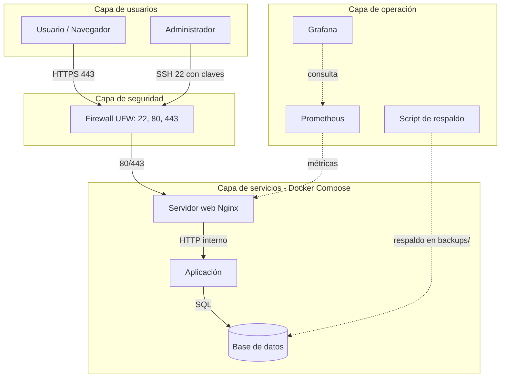

# Arquitectura del proyecto integrador

Plataforma sobre Debian 13 con Docker Compose.

## Capas
- **Usuarios:** Usuario / Navegador y Administrador.
- **Seguridad:** Firewall UFW (puertos 22, 80 y 443).
- **Servicios (Docker Compose):** Servidor web (Nginx), Aplicación y Base de datos.
- **Operación:** Prometheus, Grafana y Script de respaldo.

## Conexiones
- Usuario -> Firewall: HTTPS 443
- Administrador -> Firewall: SSH 22 con claves
- Firewall -> Servidor web: 80/443
- Servidor web -> Aplicación: HTTP interno
- Aplicación -> Base de datos: SQL
- Prometheus -> Servidor web: métricas
- Grafana -> Prometheus: visualiza los datos
- Script de respaldo -> Base de datos: respaldo en backups/

## Diagrama

